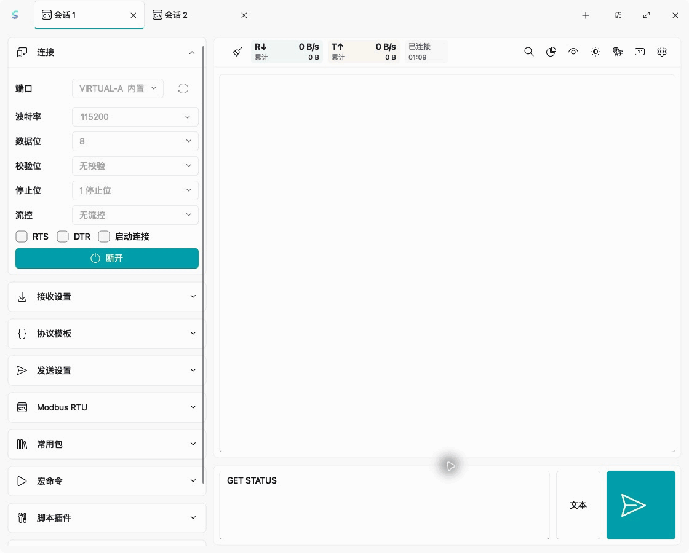
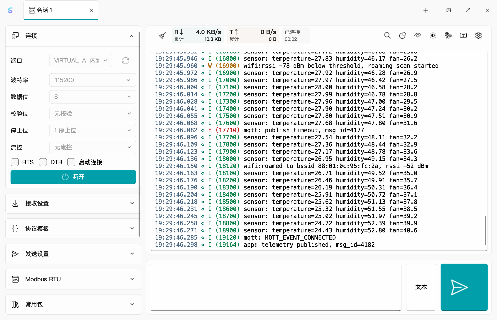
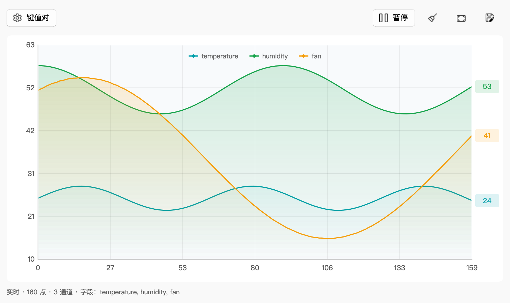
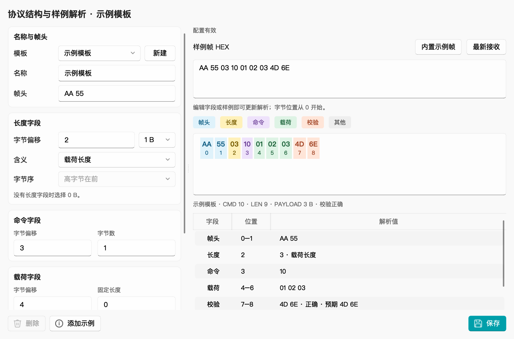
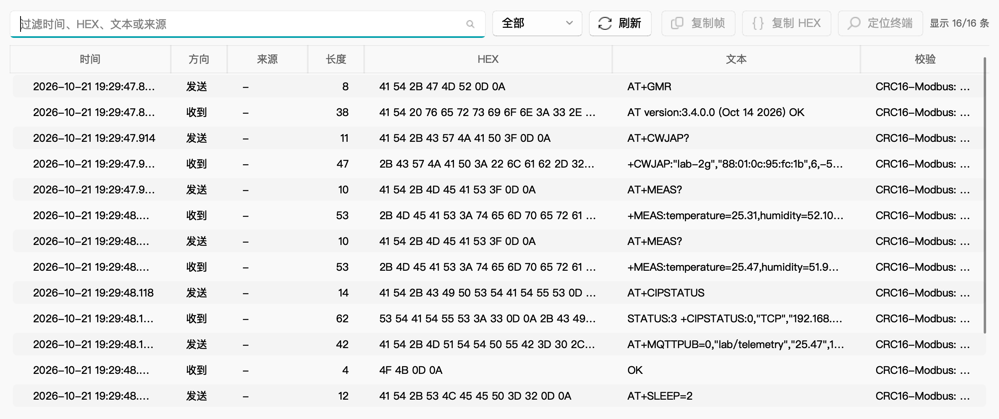

<div align="center">
  
  <h1>Fluent 串口助手</h1>
  <p>基于 C++17、Qt 6 Widgets 和 FluentQtWidgets 的跨平台串口调试工具。</p>
  <p>
    <a href="https://github.com/txp666/FluentSerialAssistant/releases/latest"></a>
    <a href="LICENSE"></a>
    
  </p>
  <p>
    <a href="README_EN.md">English</a> · 简体中文 ·
    <a href="https://github.com/txp666/FluentSerialAssistant/releases/latest">下载</a> ·
    <a href="CHANGELOG.md">变更记录</a> ·
    <a href="CONTRIBUTING.md">贡献指南</a> ·
    <a href="CODE_SIGNING_POLICY.md">Code signing policy</a>
  </p>
</div>

Fluent 串口助手提供现代 Fluent 风格的串口终端，覆盖连接、收发、显示、协议解析、绘图、自动化和导出等常用调试流程，支持 Windows、macOS 和 Linux。

## 界面预览

<p align="center">
  
</p>

<table>
  <tr>
    <td width="50%"><p align="center">终端工作台：多标签会话、日志着色和流量统计</p></td>
    <td width="50%"><p align="center">曲线窗口：按协议提取字段并实时绘图</p></td>
  </tr>
  <tr>
    <td width="50%"><p align="center">帧协议编辑器：字节结构、字段和校验一目了然</p></td>
    <td width="50%"><p align="center">数据表格：按帧查看 HEX、文本和校验结果</p></td>
  </tr>
</table>

## 下载安装

在 [Releases](https://github.com/txp666/FluentSerialAssistant/releases/latest) 下载对应平台的安装包，每个安装包都附带 `.sha256` 校验文件。

| 平台 | 安装包 | 说明 |
| --- | --- | --- |
| Windows x64 | `FluentSerialAssistant-X.Y.Z-windows-x64-setup.exe` | 安装程序，需要管理员权限，默认安装到 Program Files |
| macOS（Apple 芯片） | `FluentSerialAssistant-X.Y.Z-macos-arm64.dmg` | 打开后把应用拖到“应用程序”文件夹 |
| Linux x64 / arm64 | `FluentSerialAssistant-X.Y.Z-linux-{x64,arm64}.deb` | `sudo apt install ./FluentSerialAssistant-X.Y.Z-linux-x64.deb` |

macOS 版本未经 Apple 公证，首次打开被系统阻止时，请在“系统设置 → 隐私与安全性”中点击“仍要打开”。v0.1.14 及更新版本可在应用内检查更新，确认后自动下载、校验并安装。

## 功能特性

### 连接与收发

- 扫描串口并显示端口名、描述、厂商、VID/PID 和序列号；支持常用及扩展波特率、数据位、校验位、停止位、流控、RTS 和 DTR。
- 文本或 HEX 发送，可选 None、CR、LF、CRLF 行结束符；接收和发送可分别选择 UTF-8、GBK、ASCII、Latin1 编码。
- 毫秒级循环发送、最近 20 条发送历史，以及按块大小和间隔分块发送文件。
- 多标签会话：每个标签独立连接一个串口，新标签复制当前配置。
- 内置虚拟串口对：开启后两个会话可分别连接 `VIRTUAL-A` 和 `VIRTUAL-B` 互相收发，无需安装驱动。

### 显示与分析

- 终端支持文本、HEX、混合显示，时间戳、自动滚动和暂停显示，发送记录可自定义颜色，并实时统计收发总量、速率和连接时长。
- 自动断帧：按接收间隔、帧头、帧尾或固定长度分割记录。
- 终端搜索：关键字或正则、区分大小写、高亮跳转，并可只看接收或发送记录。
- 内容着色：内置 ESP-IDF、日志等级、成功与失败、AT 指令响应等预设，也可按关键词或正则自定义颜色。
- 曲线窗口：同时打开多个独立窗口，支持全部数字、分隔值、键值对、JSON 和二进制字段，可预览样例、筛选字段，并暂停、清空或导出 CSV。
- 数据表格：按帧查看时间、方向、来源、长度、HEX、文本和校验结果，支持排序、过滤、复制，并可定位回终端记录。

### 协议与工具

- 帧协议模板：在可视化编辑器中定义帧头、长度、命令、载荷、校验和帧尾，校验可从指定偏移开始计算，用样例或最新接收帧检查解析结果；启用后接收记录会标注命令和校验状态。
- 校验工具：CRC16-Modbus、CRC16-CCITT、CRC32、LRC、XOR、SUM8，可手动计算或在发送时自动追加；可跳过开头和末尾的字节（如帧头、帧尾），校验码插在末尾跳过的字节和换行符之前。
- Modbus RTU：生成常用读写请求、自动追加 CRC，并解析响应摘要。

### 自动化

- 常用包：分组、备注、启用/停用、批量发送、排序和 JSON 导入导出。
- 宏命令：多步骤发送、步骤延时、等待文本或 HEX 响应、循环运行、失败中止，并导出 CSV 结果。
- 自动应答：按文本、HEX 或正则匹配，立即或延时发送应答，并在记录中标记来源。
- 脚本插件：内置 JavaScript 运行器，通过受控的 `serial` API 收发数据、读取记录和写日志。
- AI 控制：通过本地 IPC、CLI 和 MCP 服务复用 GUI 当前会话，见 [AI、CLI 与 MCP 控制](#aicli-与-mcp-控制)。

### 记录与导出

- 会话记录导出为 TXT、CSV 或 BIN。
- 自动日志按 TXT、CSV、BIN 记录收发数据，文件名包含时间、串口名和波特率，可按单文件大小滚动。
- 将接收的原始数据保存到文件。

### 界面与设置

- 浅色、深色、跟随系统主题和自定义主题色；界面字体、终端等宽字体、字号和自定义字体导入。
- 简体中文和 English 无需重启即可切换。
- 恢复上次的串口参数、发送内容、常用包、宏命令、自动应答规则和文件发送参数，可选启动后自动连接；侧栏卡片记住折叠状态。
- 配置保存在系统标准的用户配置目录，不写入 Windows 注册表；升级时自动迁移旧版安装目录中的配置。

## 快速上手

1. 选择串口并设置波特率、数据位、校验位、停止位和流控，点击“连接”。
2. 在终端查看收发记录；需要时开启时间戳、自动断帧或切换 HEX 显示。
3. 在发送区输入文本或 HEX，选择行结束符和编码后发送；可勾选校验自动追加或循环发送。
4. 点击终端工具栏的曲线图标，选择解析协议并确认，即可新建一个曲线窗口。
5. 在左侧“协议模板”中点击“编辑协议”定义帧格式，保存并启用后，接收记录会显示解析结果。
6. 用常用包、宏命令、自动应答或脚本插件把重复操作自动化。
7. 点击终端工具栏最左侧的扫把按钮，同时清空终端和收发计数；用 TXT、CSV、BIN 导出记录。

### 曲线窗口

- 每次确认都会新建一个独立窗口，可同时打开多个窗口分别绘制不同字段；窗口左上角的按钮显示当前协议，点击可修改解析设置。
- 用文本或 HEX 样例预览解析结果；二进制字段可配置类型、字节偏移、大小端、比例和偏移，并从完整帧或协议模板载荷中取数。
- 窗口只绘制打开期间收到的数据，隐藏、最小化或关闭期间的数据不会补绘；最多显示 32 个通道。

### 内置虚拟串口对

1. 打开“设置”，开启“内置虚拟串口对”。
2. 在两个会话中分别选择 `VIRTUAL-A` 和 `VIRTUAL-B` 并连接；端口列表未更新时点击刷新。
3. 在任一端发送数据，另一端即可收到；也可配合自动应答规则测试请求与响应。

虚拟串口对只在同一应用实例内可用，不影响物理串口。它原样转发字节，不模拟波特率和流控；另一端未连接时发送的数据会被丢弃。

### 应用内更新

1. 启动后自动检查更新；没有新版本或无法联网时不弹窗。也可在“设置 → 应用更新”手动检查。
2. 发现新版本后先显示版本号和更新说明，点击“下载并安装”才开始下载。
3. 下载使用 4 路并行连接，显示进度并可随时取消；服务器不支持分段下载时自动改用单连接。
4. 文件大小和 SHA-256 校验通过后交给系统安装，必要时会请求权限，应用保存配置后退出。

## AI、CLI 与 MCP 控制

应用运行时，可通过 `fluentserial-cli` 或 `fluentserial-mcp` 控制 GUI 当前会话。GUI 始终是串口唯一的使用者，CLI 和 MCP 通过当前用户私有的本地 IPC 复用它的连接、协议解析、记录和曲线窗口，不会与 GUI 抢占串口。

```bash
fluentserial-cli ports
fluentserial-cli status
fluentserial-cli send-hex --hex "01 03 00 00 00 02 C4 0B"
fluentserial-cli records --direction rx --limit 20
fluentserial-cli plot --plot-protocol keyValue --plot-field "free sram" --clear
```

CLI、MCP 需与应用使用同一版本。架构、MCP 客户端配置、全部工具和 IPC 约定见 [AI 控制、CLI 与 MCP 文档](docs/ai-control.md)。

## 从源码构建

### 获取源码

项目以 Git 子模块引入 `FluentQtWidgets`：

```bash
git clone --recursive https://github.com/txp666/FluentSerialAssistant.git
cd FluentSerialAssistant
```

已克隆但没有拉取子模块时：

```bash
git submodule update --init --recursive
```

### 环境要求

- CMake 3.21+ 和 Ninja
- Qt 6.5+，包含 Widgets、SerialPort、Svg、Network、Qml 和 Core5Compat 模块（Qt 安装器中勾选 Qt Serial Port 和 Qt 5 Compatibility Module）
- Linux 另需 `libgl1-mesa-dev`、`libxcb-cursor0` 和 `libxkbcommon-x11-0`

### Windows（MinGW）

`CMakePresets.json` 默认使用 `C:/Qt/6.11.1/mingw_64` 和 `C:/Qt/Tools/mingw1310_64`，路径不同时请修改预设。

```powershell
cmake --preset mingw-release
cmake --build --preset mingw-release --parallel
.\build\mingw-release\FluentSerialAssistant.exe
```

Debug 构建使用 `mingw-debug` 预设。链接时提示 `cannot open output file FluentSerialAssistant.exe: Permission denied`，通常是旧程序仍在运行。

### macOS 和 Linux

```bash
cmake -S . -B build/release -G Ninja -DCMAKE_BUILD_TYPE=Release -DCMAKE_PREFIX_PATH=/path/to/Qt/6.x/<平台目录>
cmake --build build/release --parallel
```

Qt 已在默认搜索路径中时可省略 `CMAKE_PREFIX_PATH`。

### 运行测试

```bash
ctest --test-dir build/release --output-on-failure
```

测试默认随项目构建，使用 Qt 的 offscreen 平台运行，不需要显示器或真实串口。

### VS Code

仓库内置 `.vscode/tasks.json`：`Ctrl+Shift+B` / `Cmd+Shift+B` 执行 Debug 构建，`F5` 构建并启动调试。Windows 下复用 MinGW 预设，macOS 和 Linux 下使用 `build/vscode-debug` 或 `build/vscode-release` 目录。

## 发布

GitHub Actions 只在 GitHub Release 发布时运行。

1. 更新 `CMakeLists.txt` 中的版本号、`CHANGELOG.md` 和 `docs/release-notes/vX.Y.Z.md`，并推送到 main。
2. 在 GitHub 上以 `vX.Y.Z` 为标签和标题发布 Release。
3. 工作流先把该 Release 标为预发布，在三个平台上运行测试并构建安装包；全部校验通过并上传后，再转为正式版并标记为最新。构建失败时它保持预发布，应用内更新不会看到它。

产物包括 Windows x64 安装程序、macOS arm64 DMG、Linux x64/arm64 DEB 及各自的 `.sha256` 文件。Windows 发布支持 SignPath Foundation 的免费开源 Authenticode 签名：配置后先签名 `FluentSerialAssistant.exe`，再构建并签名安装程序，见 [SignPath 设置说明](docs/signing/SIGNPATH_SETUP.md)。

本地打包可使用 `scripts/package_release.ps1`（Windows 便携包），三平台安装包的底层脚本为 `scripts/package_windows.ps1`、`scripts/package_unix.sh` 和 `scripts/create_deb_package.sh`。

## 目录结构

```text
.
├── .github/workflows/   # Release 测试与打包工作流
├── docs/
│   ├── ai-control.md    # AI、CLI 与 MCP 控制说明
│   ├── images/          # README 截图
│   ├── release-notes/   # 各版本发布说明
│   └── signing/         # 代码签名配置说明
├── packaging/windows/   # Inno Setup 安装程序定义和翻译
├── scripts/             # 打包脚本
├── signing/signpath/    # SignPath 签名产物配置
├── src/
│   ├── app/control/     # 会话控制接口和本地 IPC
│   ├── app/core/        # 协议、校验、绘图解析、编码、更新等通用逻辑
│   ├── app/resources/   # Qt 资源、图标和翻译
│   ├── app/serial/      # 串口封装和内置虚拟串口对
│   ├── app/view/        # 主窗口、设置页、曲线、协议编辑器等界面
│   │   └── workbench/   # 终端工作台，按功能拆分为连接、终端、发送、宏、脚本等文件
│   ├── cli/             # 命令行工具
│   └── mcp/             # MCP stdio 服务
├── tests/               # Qt Test 自动化测试
└── third_party/FluentQtWidgets/
```

## 许可证

本项目采用 GNU General Public License v3.0 or later，详见 [LICENSE](LICENSE)。项目依赖的 `FluentQtWidgets` 同样采用 GPL-3.0-or-later，分发本项目或其派生版本时需遵守 GPL 的源代码开放和再分发要求。

## 相关项目

- [FluentQtWidgets](https://github.com/txp666/FluentQtWidgets)

## Code signing policy

Free code signing is provided by [SignPath.io](https://signpath.io/), with a
certificate from [SignPath Foundation](https://signpath.org/), after the
project's open-source application is approved. Team roles, release controls,
signed artifact scope, and the privacy statement are documented in the
[code signing policy](CODE_SIGNING_POLICY.md) and [privacy policy](PRIVACY.md).
